<p align="center">
  
</p>

<h1 align="center">Terratone</h1>

<p align="center">
  <strong>Listen to the planet.</strong><br>
  Terratone turns NASA Earth visualizations into live music made from the data in every frame,<br>
  so blind, low-vision and sighted visitors can all follow how Earth changes.
</p>

<p align="center">
  <a href="https://inmyownuniverse.github.io/NASA-Space-Apps-Challenge-2026_5DS/"><strong>▶ Live demo</strong></a> ·
  <a href="#run-it-locally">Run locally</a> ·
  <a href="docs/mapping-notes.md">How each dataset sounds</a> ·
  <a href="add.html">Add your own visualization</a>
</p>

<p align="center"><em>Built in 48 hours for the NASA Space Apps Challenge 2026 (November 14–15, 2026) by team 5DS.</em></p>

---

## Contents

- [The problem](#the-problem)
- [Our solution](#our-solution)
- [Features](#features)
- [The four datasets and how they sound](#the-four-datasets-and-how-they-sound)
- [How it works](#how-it-works)
- [Accessibility](#accessibility)
- [Accuracy and limits](#accuracy-and-limits)
- [How we built it](#how-we-built-it)
- [Run it locally](#run-it-locally)
- [Project structure](#project-structure)
- [Testing and validation](#testing-and-validation)
- [Team](#team)
- [Data, credits and license](#data-credits-and-license)

---

## The problem

NASA's [Earth Information Center](https://svs.gsfc.nasa.gov/gallery/earth-information-center/) (EIC)
shows some of the best Earth science visualizations in the world: ocean currents, lightning, city
lights and the air we breathe. They show their data through **colour and motion**. A blind or
low-vision visitor can't see those cues, and a colour bar means nothing to someone who can't see it.

## Our solution

Terratone is a web app that **sonifies** EIC visualizations: it turns them into sound. It reads the
real video, frame by frame, works out what the data in each frame shows, and plays it as music
with Tone.js. It rests on three ideas:

1. **The sound follows the data, not the colours.** For sea surface temperature we invert the
   colour bar, turning each pixel's colour back into a temperature in °C, so a higher note means
   warmer water, not just a redder pixel. For the other datasets we measure what the picture
   actually shows: how bright each area is, each *new* lightning strike, and which aerosol type
   each coloured pixel belongs to.
2. **You can explore it by touch, mouse or keyboard.** Point anywhere on a globe or flat map and
   hear the value at that spot. A proof panel shows exactly how that note was worked out, and
   phones vibrate on hotspots.
3. **It works for any visualization.** One engine reads one JSON config per dataset. The
   [Add a visualization](add.html) page turns any video or image that has a colour bar into a
   playable config in the browser, without changing any code.

## Features

| | What it does |
|---|---|
| 🎵 **Play** | The music follows the video as it plays. Scrub, loop and change the volume. |
| ↔️ **Scan** | Pauses on one frame and sweeps a line from west to east. Each column of the map becomes a chord (south = low octave, north = high octave). Inspired by NASA's [Caldwell 73 sonification](https://svs.gsfc.nasa.gov/13786/). |
| 🌍 **Explore** | A 3D globe (Three.js) or a flat map. Click, drag, tap or use the arrow keys to hear any spot, or pick a marked location. The **proof panel** shows the pixel colour, where it sits on the colour bar, the value it stands for and the note played. |
| 🎼 **Planet Symphony** | All four datasets play together as one piece, each with its own level slider. |
| 📖 **Sonic legend** | Before playback, each sound is spoken and played as an example ("high notes mean warm water"). Narration is available in English and, with the optional server, ten Indian languages. |
| 🙈 **Eyes-closed mode** | Hides the picture and speaks a short summary of the data every few seconds, so you can follow along without a screen. |
| 🔴 **Record track** | Records the live mix and downloads it as a WAV file. |
| 🔗 **Shareable links** | Links such as `?dataset=sst&t=30&mode=scan` open a dataset at a given time and mode. |
| ➕ **Add a visualization** | Five steps: upload, mark the map area, mark the colour bar, choose a sound, then review. You hear the result with the same engine and can download its dataset config. A one-click example is included. |
| 🪨 **Rocky, the guide** | An animated guide gives a tour of the page or explains one section. With the optional server, Rocky also answers science questions about the dataset on screen. |

### Keyboard shortcuts

| Key | Action |
|---|---|
| <kbd>Space</kbd> | Play / pause |
| <kbd>←</kbd> <kbd>→</kbd> | Seek |
| <kbd>↑</kbd> <kbd>↓</kbd> | Volume |
| <kbd>1</kbd>–<kbd>4</kbd> | Choose a dataset |
| <kbd>M</kbd> | Change mode |
| <kbd>L</kbd> | Play the sonic legend |
| <kbd>D</kbd> | Speak the current reading |
| <kbd>E</kbd> | Eyes-closed mode |
| <kbd>R</kbd> | Start or stop recording |
| <kbd>Esc</kbd> | Stop all sound |

Planet Symphony supports <kbd>Space</kbd> and <kbd>Esc</kbd>. In Explore, the arrow keys move
around the map, and <kbd>Tab</kbd> / <kbd>Enter</kbd> reach the dataset selector and the marked
locations.

## The four datasets and how they sound

Each dataset has its own mapping, chosen to suit the data. Every note comes from a **pentatonic
scale**, so any mix of notes sounds consonant. **Left and right in the stereo field follow west and
east.** Full reasoning for each choice is in [`docs/mapping-notes.md`](docs/mapping-notes.md).

| Dataset | What we measure in each frame | What you hear |
|---|---|---|
| 🌊 **Sea Surface Currents and Temperature** ([SVS 3912](https://svs.gsfc.nasa.gov/3912/)) | Real temperature in °C (0–32 °C), read through the colour bar from the visible current streamlines on a 32 × 16 grid | A slow, warm pad chord. Warmer water gives higher notes, and a wide temperature range gives a wide chord. Fast-moving currents make the tone brighter. Water above 31 °C adds a tense note a semitone up. |
| ⚡ **Lightning from the ISS** ([SVS 5011](https://svs.gsfc.nasa.gov/5011/)) | Each **new** flash and its position, found from its white core and yellow halo | Deep drum hits, one to four per burst. A flash's position on screen sets its stereo pan and drum pitch, and brighter flashes hit harder. No lightning means silence. |
| 🌃 **Night Lights 2012–2023** ([SVS 5313](https://svs.gsfc.nasa.gov/5313/)) | Brightness of each area (a 0–100 index), year by year | Sparkling glass notes. More lit area means more notes per burst, brighter places play higher and louder, and a growing lit area adds an extra sparkle. |
| 🌫️ **GEOS Aerosols** ([SVS 5572](https://svs.gsfc.nasa.gov/5572/)) | The share of the picture covered by each aerosol type, classified by hue: dust, black carbon, sea salt and sulfate | Four instruments on one shared chord: a cello-like drone for dust, fire-like crackle for black carbon, an airy shimmer for sea salt and soft bells for sulfate. Each gets louder as its share grows. |

## How it works

```
 NASA SVS video ──► frame ──► crop + mask ──► 32 × 16 grid ──► features ──► mapper ──► Tone.js ──► 🔊
                                                   │                            │
                                         colour-bar inversion            screen reader, speech,
                                         (pixel colour → °C)             vibration, proof panel
```

1. **Read the frame.** [`js/player.js`](js/player.js) draws the current video frame to a canvas
   about four times a second.
2. **Crop and mask.** [`js/analyzer.js`](js/analyzer.js) crops to the map, masks out burned-in
   labels, legends, captions and pop-out panels, and splits the map into a 32 × 16 grid.
3. **Extract the data.** Each kind of visualization has its own extractor:
   - *Continuous field* (SST): [`js/colorbar.js`](js/colorbar.js) matches each pixel to the
     calibrated colour-bar stops and interpolates between them to recover °C. Land, ocean floor
     and labels are rejected when their colour is too far from the colour bar.
   - *Events* (lightning): pixel-level blob detection and frame-to-frame tracking, so only new
     strikes make sound. A least-squares circle fit finds the globe's disc, which rejects stars
     and artefacts outside it.
   - *Density* (night lights): a brightness index per cell, with the hyperwall's duplicated world
     map handled so each longitude is counted once.
   - *Layers* (aerosols): hue-based classification of translucent species layers, using floors
     relative to each species' colour.
4. **Map features to music.** [`js/sound/mappers.js`](js/sound/mappers.js) turns the features
   into notes, chords, rhythm, panning and filter brightness on a scale from
   [`js/sound/scales.js`](js/sound/scales.js). Values are smoothed over a few frames, chords change
   at most twice a second, and at most 8 notes play at once, so the music stays clear.
5. **Play it.** [`js/sound/engine.js`](js/sound/engine.js) and
   [`js/sound/instruments.js`](js/sound/instruments.js) synthesise every instrument in code with
   Tone.js, so there are no sample files to host. The signal goes through a reverb and a limiter.
   Every sound setting is in [`js/sound/tuning.js`](js/sound/tuning.js) and can be tuned by ear in
   [`tools/sound-lab.html`](tools/sound-lab.html).
6. **Describe it.** [`js/a11y.js`](js/a11y.js) and [`js/eyes.js`](js/eyes.js) announce readings
   to screen readers, speak summaries and vibrate on hotspots.

### One config per dataset

Everything specific to a dataset is in a JSON file in [`datasets/`](datasets/): the video, the
crop box, masks, the grid, colour-bar stops, latitude range, the sound block (mapper, scale,
instrument) and the legend text. Adding a visualization means adding a config, not changing the
engine:

```jsonc
{
  "id": "sst",
  "video": "media/sst.mp4",
  "crop": { "x": 0, "y": 0, "w": 1280, "h": 600 },
  "grid": { "w": 32, "h": 16 },
  "colorbar": { "unit": "°C", "stops": [{ "rgb": [45, 81, 216], "value": 0.0 }, "..."] },
  "sound": { "mapper": "continuousField", "scale": "C major pentatonic", "instrument": "warmPad" },
  "legend": [{ "sound": "high notes", "means": "warm water" }]
}
```

## Accessibility

Accessibility is the main goal of Terratone, not an add-on.

- **Fully usable by keyboard:** shortcuts for every main action, arrow-key exploration, a skip
  link, and visible focus states.
- **Screen-reader support:** ARIA live regions announce readings (throttled so they don't flood
  the listener), and controls use labelled ARIA groups.
- **Built-in speech** (Web Speech API) for the legend, readings and eyes-closed summaries.
- **Vibration** (Vibration API) on hotspots while exploring by touch.
- **A sonic legend before playback**, so a listener learns what each sound means before the music
  starts.
- **Reduced motion respected:** animations turn off when `prefers-reduced-motion` is set.
- **Narration in 11 languages** (English plus ten Indian languages) through the optional server.
- **Works without the videos:** if a video can't load, that dataset plays clearly labelled
  *sample data* instead of failing silently.

## Accuracy and limits

We aim to be honest about what the sound can and cannot tell you:

- **Sea surface temperature** is real °C read from the colour bar, but only for the moving current
  lines you can see, not an average over the whole ocean. Reading colours from compressed video is
  accurate to about 1–2 °C. Explore reads a small 7 × 7 pixel patch and matches it in CIELAB colour
  space, so it can differ from the music by about a degree at the same spot.
- **Night lights** is how bright the picture looks (a 0–100 index), not a measured radiance. The
  parts of the video that show a change map use a different colour scale, so they are silent.
- **Lightning** counts the strikes the visualization draws. The globe moves and zooms, so left and
  right in the sound mean left and right on the screen, not east and west on Earth.
- **Aerosols** are shares of coloured picture area, not mass or optical depth.
- All four are made from NASA **visualizations**, not from the raw science data files.

## How we built it

We split the work into five roles (data and vision, sound design, frontend and accessibility,
story and product, and explore/export). Each had its own Git branch, and we merged into an
`integration` branch at regular check-ins before merging into `main` for submission.

**Data and vision first.** We didn't guess at colours or layouts: we measured them from the
frames. Some examples:

- The **SST** colour bar was sampled into 16 calibrated RGB stops with
  [`tools/sample_colorbar.py`](tools/sample_colorbar.py), and the crop was checked against the
  video's real latitude range (90° N to 78.75° S).
- The **Night Lights** EIC master is a 7680 × 2160 HEVC file made for a two-screen hyperwall.
  Cross-correlation showed it holds the **same world map twice**, so the analyser reads one copy
  only. We re-encoded a 1920 × 540 H.264 version that every browser can play, and masked 12
  pop-out annotation rectangles, checked against the frame pixel by pixel.
- For **Lightning**, a first version found the globe from the lit crescent and got it badly wrong
  on night-side frames. We replaced it with a trimmed least-squares circle fit, and checked it
  against an independent ffmpeg fit to within about 1 px.
- For **Aerosols**, we traced the video to the right SVS source (5572, not 5669) by content
  (PSNR ≈ 31 dB against the official frames). We also explained why plume colours didn't match the
  legend swatches: they are translucent layers over a dark map, which keeps the hue but lowers
  the saturation. So we classify by hue.

The full measurements are in [`media/README.md`](media/README.md).

**Then sound design.** Every mapping was designed so a listener can learn it in seconds: pitch
for temperature, rhythm for events, note density for lit area, and timbre for particle type. All
the numbers are in one tuning file so they could be balanced by ear in the Sound Lab without
touching the analyser.

**Then the experience.** The landing page, Play, Scan, Explore (globe and flat map), Planet
Symphony, the legend, eyes-closed mode, recording, sharing, the Add page and the Rocky guide were
built on top of that engine.

### Tech stack

| Area | Tools |
|---|---|
| App | Plain HTML, CSS and JavaScript (ES modules). No build step and no framework. |
| Sound | [Tone.js](https://tonejs.github.io/) 15 on the Web Audio API |
| 3D globe | [Three.js](https://threejs.org/) (included in [`js/vendor/`](js/vendor/)) |
| Accessibility | Web Speech API, Vibration API, ARIA live regions |
| Video and image processing | Canvas 2D in the browser, ffmpeg for re-encoding, Python with Pillow and NumPy for colour-bar sampling |
| Optional server | Node.js 20+, with no dependencies. [Groq](https://groq.com/) powers Rocky's chat; [Sarvam AI](https://www.sarvam.ai/) handles translation and Indian-language speech. |
| Hosting | GitHub Pages |

## Run it locally

The app is a static site. It has to be served over `http://`, because opening `index.html`
directly with `file://` won't work.

```bash
git clone https://github.com/inmyownuniverse/NASA-Space-Apps-Challenge-2026_5DS.git
cd NASA-Space-Apps-Challenge-2026_5DS
```

**Option A: VS Code Live Server (recommended).** Open the folder in VS Code, install the
recommended **Live Server** extension, then right-click `index.html` → **Open with Live Server**.

**Option B: Python.** Run `python -m http.server` and open <http://localhost:8000>.
(Python's simple server doesn't support seeking within videos, so scrubbing and shared links with
a time work best with Live Server or Option C.)

**Option C: the Terratone server (enables Rocky's chat and multilingual narration).**

1. Install [Node.js](https://nodejs.org) 20 or newer.
2. Create a `.env` file in the repo folder. It is already in `.gitignore`. Either line can be left
   out, and that feature just stays off:
   ```
   GROQ_API=your-groq-key
   SARVAM_API=your-sarvam-key
   ```
3. Run `node server.mjs` and open <http://127.0.0.1:8000/>.

The server serves only the app's own files and never serves `.env` or any other dot-file or env
file. API keys stay on the server and are never sent to the browser. On GitHub Pages, the page tour
still works, and the legend falls back to the browser's English voice.

### Deploy to GitHub Pages

Go to **Settings → Pages → Deploy from a branch**, choose `main` and `/ (root)`, and save. Every
path is relative and every video is under 100 MB, so nothing else is needed.

## Project structure

```
├── index.html              Main app: landing, Play / Scan, Explore, Planet Symphony
├── add.html                "Add a visualization" wizard
├── server.mjs              Optional Node server (Rocky chat + narration, keys kept server-side)
├── css/style.css
├── datasets/               One JSON config per dataset (+ index.json)
├── media/                  Web-sized copies of the NASA SVS videos and previews (see media/README.md)
├── js/
│   ├── main.js             App wiring, routing, modes, keyboard shortcuts, sharing
│   ├── player.js           Video loop: analyse → sound → description
│   ├── analyzer.js         Frame → crop → masks → grid → features (all four extractors)
│   ├── colorbar.js         Colour-bar inversion (pixel colour → value)
│   ├── colormatch.js       Patch-based CIELAB matching for Explore
│   ├── explore.js          Explore mode and the proof panel
│   ├── globe-explore.js    Three.js globe view
│   ├── a11y.js · eyes.js   Announcements, speech, vibration, eyes-closed mode
│   ├── landing.js          Animated landing page
│   ├── rocky.js            Guide tour and chat
│   ├── add.js              Add-a-visualization logic
│   └── sound/
│       ├── engine.js       Master chain, voices, Scan, Symphony
│       ├── mappers.js      continuousField · events · density · layers · scanColumn
│       ├── instruments.js  Instruments synthesised in code
│       ├── scales.js       Value → note on a scale
│       ├── tuning.js       Every sound setting in one place
│       ├── export.js       Record → WAV
│       └── demo.js         Labelled sample data when a video is missing
├── tools/                  Tests, colour-bar sampler, Sound Lab, audit pages
└── docs/                   Mapping notes and integration guides
```

## Testing and validation

The data extractors run against the real video frames in Node:

```bash
node tools/test_lightning.mjs     # 91 checks
node tools/test_nightlights.mjs   # 98 checks
node tools/test_aerosols.mjs      # 109 checks
node tools/test_pipeline.mjs      # SST config, colour-bar inversion and feature contract
```

`test_pipeline.mjs` also needs Python with Pillow (`pip install -r tools/requirements.txt`) and a
local SST still at `tools/sst_still.png`, which is not committed. Other tools:

- [`tools/sound-lab.html`](tools/sound-lab.html): tune every sound setting by ear and copy the
  values back into `tuning.js`.
- [`tools/sample_colorbar.py`](tools/sample_colorbar.py): sample a colour bar from a screenshot
  into config stops (`python tools/sample_colorbar.py --help`).
- [`tools/verify_crop.py`](tools/verify_crop.py) and
  [`tools/verify_video_playback.mjs`](tools/verify_video_playback.mjs): check crops and video
  playback.
- `tools/audit/`: browser pages for visual QA of the proxies and the lightning detector.
- Add `?debug=1` to the address to see exactly which video pixel Explore reads.

## Team

| Member | Role | Main contributions |
|---|---|---|
| **Aahana** | Data & Vision | Frame analyser, colour-bar inversion, the four extractors, media processing, validation tools |
| **Freia** | Sound Design | Sound engine, scales, instruments, mappers, tuning and the Sound Lab |
| **Hazel** | Frontend & Accessibility | Interface, player, accessibility layer, landing page, Rocky, deployment |
| **Celene** | Story & Product | Narrative, documentation, mapping notes, spoken text |
| **Jaden** | Explore & Export | Explore mode and proof panel, colour matching, audio export |

## Data, credits and license

| Dataset | Source |
|---|---|
| Sea Surface Currents and Temperature | [NASA Goddard SVS, ECCO2 with NASA/JPL](https://svs.gsfc.nasa.gov/3912/) |
| Lightning from the ISS | [NASA SVS, ISS Lightning Imaging Sensor, NASA GHRC DAAC, Blakeslee 2020](https://svs.gsfc.nasa.gov/5011/) |
| Night Lights 2012–2023 | [NASA SVS, Black Marble, Suomi NPP VIIRS, NASA/NOAA](https://svs.gsfc.nasa.gov/5313/) |
| GEOS Aerosols | [NASA GMAO and SVS, GEOS-FP animation](https://svs.gsfc.nasa.gov/5572/); preview still from [SVS 5669](https://svs.gsfc.nasa.gov/5669/) |

- Visualizations courtesy of NASA's [Scientific Visualization Studio](https://svs.gsfc.nasa.gov/).
  The videos in `media/` are smaller re-encodes of the SVS originals so the site can run on GitHub
  Pages. Their provenance is documented in [`media/README.md`](media/README.md).
- Scan mode was inspired by [Data Sonification: Caldwell 73](https://svs.gsfc.nasa.gov/13786/).
- Three.js is MIT-licensed; its license is in [`js/vendor/three.LICENSE`](js/vendor/three.LICENSE).
  Tone.js is MIT-licensed and loaded from [esm.sh](https://esm.sh/).

<p align="center"><sub>Made for the NASA Space Apps Challenge 2026 · Listen to the planet 🌍🎶</sub></p>
